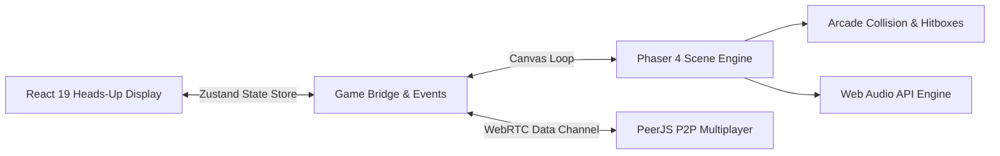

# Ben 10: Alien Battle Arena 🛸⚡

> **High-Performance 2D Fighting Game Engine built with Phaser 4, React 19, TypeScript, PeerJS & Web Audio API**

[](https://game-rovenor.vercel.app)
[](https://phaser.io/)
[](https://react.dev/)
[](https://www.typescriptlang.org/)
[](https://peerjs.com/)
[](https://tailwindcss.com/)

---

## 🎮 Game Overview

**Ben 10: Alien Battle Arena** is a fast-paced, browser-based 2D fighting arena game. Players transform into iconic Omnitrix aliens—each with distinct biological traits, special elemental attacks, knockback physics, and tactical abilities.

The game bridges the **Phaser game canvas** with a modern **React 19 UI overlay**, utilizing **Zustand** for cross-boundary state management, **Web Audio API** for procedural sound design, and **PeerJS** for peer-to-peer multiplayer combat.

---

## 💥 Alien Roster & Combat Attributes

```text
┌────────────────┬──────────────┬──────────────┬───────────────┬──────────────────────────────────────┐
│ Alien          │ Homeworld    │ Element      │ Playstyle     │ Signature Move                       │
├────────────────┼──────────────┼──────────────┼───────────────┼──────────────────────────────────────┤
│ 🔥 Heatblast   │ Pyros        │ Fire / Magma │ Ranged Zoner  │ Supernova Flame Burst & Magma Jab    │
│ 💎 Diamondhead │ Petropia     │ Crystal      │ Defensive Tank│ Crystalline Spikes & Shard Projectile│
│ ⚡ XLR8        │ Kinet        │ Friction     │ Speed Rush    │ Supersonic Dash & Kineti-Kick        │
│ 🥊 Four Arms   │ Khoros       │ Brute Force  │ Heavy Brawler │ Ground Smash & Quad-Fist Uppercut    │
└────────────────┴──────────────┴──────────────┴───────────────┴──────────────────────────────────────┘
```

Each alien entity is governed by mathematical physics metrics:
- **Health Points ($HP$) & Energy Reserves ($EP$)**
- **Dynamic Knockback Vectors** ($v_x, v_y$) on hit confirmation
- **Cooldown Systems & Frame Timings** (startup, active, recovery)
- **Hurtbox & Hitbox Intersections** calculated in real-time

---

## 🕹️ Controls

| Action | Player 1 (Keyboard) | Player 2 (Local 1v1) |
| :--- | :--- | :--- |
| **Move Left / Right** | `A` / `D` | `Left` / `Right` Arrow |
| **Jump** | `W` | `Up` Arrow |
| **Crouch / Block** | `S` | `Down` Arrow |
| **Light Punch** | `J` | `Num 1` |
| **Heavy Kick** | `K` | `Num 2` |
| **Special Elemental Move** | `L` | `Num 3` |
| **Omnitrix Ultimate** | `U` / `Space` | `Num 0` |

---

## 🏗️ Architecture & Technical Stack



- **Phaser 4 Engine:** High-performance WebGL/Canvas rendering pipeline managing sprite sheets, particle emitters, camera shakes, and collision layers.
- **React 19 Overlay:** Character selection screen, dynamic health bars, energy meters, pause overlays, and match victory banners.
- **PeerJS P2P Networking:** Direct peer-to-peer WebRTC data channels for low-latency online multiplayer without dedicated match servers.
- **Web Audio API:** Real-time procedural audio synthesis for laser blasts, energy charging, and combat impacts.

---

## 🚀 Getting Started

### Prerequisites
- **Node.js** (v18+)
- **npm** or **bun**

### Installation

1. **Clone the repository:**
   ```bash
   git clone https://github.com/PackhunterforCynic/game.git
   cd game
   ```

2. **Install dependencies:**
   ```bash
   npm install
   ```

3. **Start local development server:**
   ```bash
   npm run dev
   ```

4. **Build for production:**
   ```bash
   npm run build
   ```

---

## 👨‍💻 Author

**Robinson J. ([@PackhunterforCynic](https://github.com/PackhunterforCynic))**  
*Creative Technologist & Game Developer*  
Portfolio: [robinsonj.vercel.app](https://robinsonj.vercel.app) • LinkedIn: [linkedin.com/in/robinson-mj](https://linkedin.com/in/robinson-mj)
